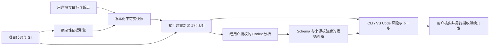

# Project Context Manager：面向 AI 开发协作的证据化上下文恢复

## 项目定位

在使用 AI 编程助手时，新会话需要重新理解项目；旧聊天中的“已完成”和“测试通过”也可能已与当前代码不一致。本项目把开发目标、断点、WIP、下一步与 Git/文件证据存成版本化交接记录，并在接手时重新核验。目标是帮助用户和 Agent 判断哪些信息仍可靠，而不是仅保存一段聊天摘要。

已提供 TypeScript 核心引擎、CLI、VS Code 扩展及 Codex 语义分析适配器。当前是本地 alpha.2；Windows 有实际运行证据，完整跨平台与产品发布验收仍待完成。

## 工程亮点与证据

| 能力 | 实现方式 | 可复查依据 |
| --- | --- | --- |
| 项目状态可追溯 | 独立采集 Git HEAD、index、磁盘、未跟踪文件；SHA256 与 Worktree 身份 | [采集引擎](../packages/engine/src/collect.ts)、[基础测试](../tests/m1.test.ts) |
| 接手避免复用过时结论 | 比较当前基线与历史快照，报告文件漂移、陈旧验证和声明证据冲突 | [操作引擎](../packages/engine/src/operations.ts)、[存储与恢复测试](../tests/m2.test.ts) |
| AI 输出有边界 | Codex 返回结构化候选结果；AJV 校验字段与证据来源，不直接认证功能完成 | [适配器](../packages/adapters/src/index.ts)、[适配器测试](../tests/adapters.test.ts) |
| 恢复保护开发现场 | 不自动执行任务或保存缓冲区；比对源码、Git index 与记录的恢复前后哈希 | [演示脚本](../scripts/demo.mjs)、[GUI 验收](next/gui-acceptance-2026-10-11.md) |
| 交接过程可靠 | 预览后发布、不可变快照、并发与陈旧预览拒绝；版本化 JSON/Markdown | [存储](../packages/engine/src/store.ts)、[协议](../packages/protocol/src/index.ts) |
| 多入口共用核心 | 引擎不依赖 VS Code；CLI、GUI 与 Skill 使用共享证据规则 | [架构](next/architecture.md)、[扩展](../packages/vscode/src/extension.ts) |
| 可演示和交付 | 单命令离线场景演示、限定内容的本地 VSIX 打包、三平台 CI 配置 | [演示指南](demo.md)、[打包脚本](../scripts/package-vsix.mjs)、[CI](../.github/workflows/ci.yml) |

## 数据与授权流

机器核验解决文件、Git 和记录的一致性，AI 分析补充目标、实现与约束的语义理解。两类证据分别呈现；交接文档内容不能自行授予执行权限。

## 可用于简历的项目描述

**Project Context Manager｜AI 开发协作与上下文恢复工具**  
技术栈：TypeScript、Node.js、Git、JSON Schema/AJV、VS Code Webview、Vitest、esbuild。

- 设计并实现面向 AI 编程会话交接的上下文恢复工具，以版本化 JSON/Markdown 保存项目目标、开发断点及 WIP，并提供 CLI 与 VS Code 图形入口。
- 构建 Git HEAD/index/磁盘证据采集与 SHA256 基线比对机制，识别源码漂移、陈旧验证和历史声明冲突；采用不可变快照及并发发布检查保护交接记录。
- 接入 Codex 结构化语义分析，对候选判断执行 Schema 和来源校验，将模型判断与机器验证分离，恢复流程保持只读及显式执行授权。
- 建立自动化回归、真实扩展宿主和端到端演示；2026-10-13 Windows 本次运行 8 个测试文件、30 项测试通过，7 个离线合成场景通过，并保留可复查结果。

上述数字是当前执行覆盖，不是效率提升或准确率指标。若无法说明独立承担的部分，不应将全部内容写成个人独立完成；投递时应按实际贡献调整措辞。

## 面试演示与讲解顺序

1. 用 `npm run demo` 展示交接保存、只读恢复与源码漂移，再打开生成报告和原始 JSON。
2. 用 VSIX 演示目标/WIP 表单、恢复结果以及可见风险；解释为什么“已读取交接”不等于“项目完成”。
3. 展示一个历史验证失效或篡改拒绝案例，讲清楚如何避免 Agent 沿过时状态继续开发。
4. 说明引擎与宿主的分层、快照并发一致性及 AI 候选结果校验，再交代真实验收范围与剩余风险。

适合 AI 应用、Agent 工程和 AI 融合开发岗位中的工程实践展示；它没有训练模型，也没有已证实的检索增强生成流程，不能包装成模型训练或 RAG 项目。

## 真实验证与后续收尾

- [2026-10-11 GUI 验收](next/gui-acceptance-2026-10-11.md)：真实交接/恢复、漂移和合成损坏记录。
- [新会话接手实验](next/receiving-experiment.md)：独立读取记录、识别过时状态并完成打包小任务；有初始任务提示，不是盲测。
- [2026-10-13 当前验证](next/validation-2026-10-13.md)：完整自动化回归和离线演示。
- [收尾清单](next/completion.md)：所有剩余项按证据跟踪。尚未执行的权限拒绝、运行中 GUI 取消/重试、平台和用户研究保持未完成。
